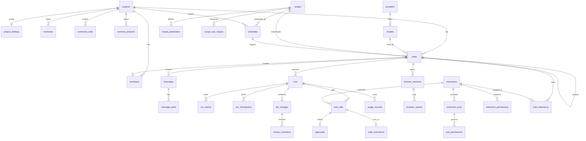
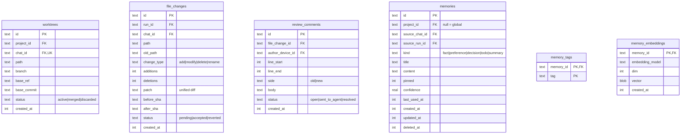
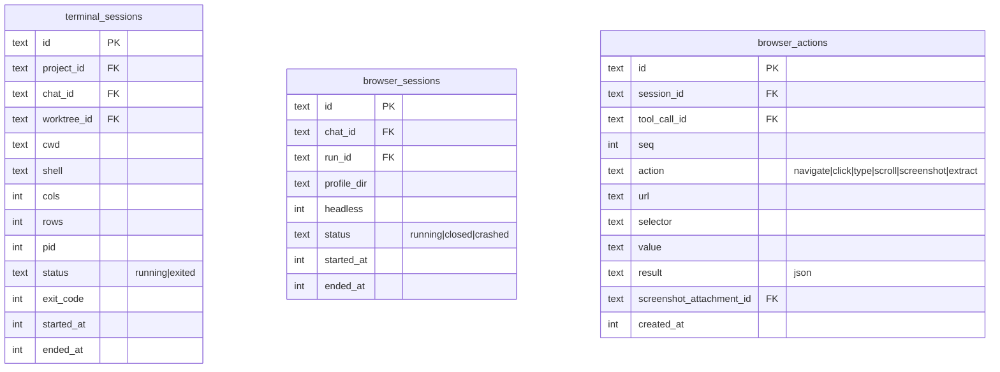
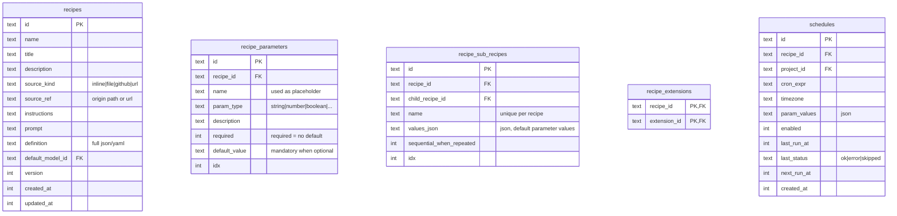
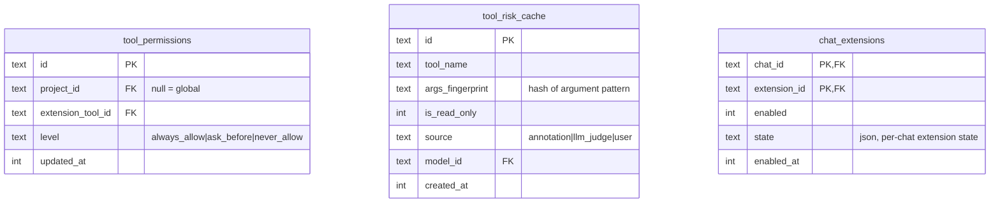

# Gaggle — Database ERD & Architecture Specification

Database schema and workspace architecture for **Gaggle**, a self-hosted personal AI agent that operates directly inside real local workspaces and projects. Written entirely in **Rust**, Gaggle uses a single local **SQLite** database per device (`gaggle.db`), inspired by **Goose** (Block's open-source Rust AI agent).

---

## 1. Conventions

| Aspect | Rule |
| :--- | :--- |
| **Primary Key** | Time-ordered UUIDv7 stored as `TEXT` (generated by the application) |
| **Timestamps** | `INTEGER`, Unix epoch in milliseconds |
| **JSON** | Stored as `TEXT` with `CHECK(json_valid(column))` |
| **Boolean** | `INTEGER` (`0` or `1`) with `CHECK(column IN (0, 1))` |
| **Enums** | `TEXT` with `CHECK(column IN (...))` |
| **Secrets** | API keys and OAuth tokens are **never** stored in the DB. `secret_ref` points to the OS Keychain (`keyring`) |
| **Soft Delete** | `archived_at` / `deleted_at` columns (`NULL` = active) |
| **Large Files** | Attachments, screenshots, and large patches are stored on disk in the data directory; the DB stores only `storage_path` and `sha256` |

---

## 2. Storage Decisions

- **Single Global SQLite Database**: Stored at `~/.local/share/gaggle/gaggle.db` (Linux) or `~/Library/Application Support/gaggle/gaggle.db` (macOS), resolved via the `directories` crate.
- **Why Not Per-Project Databases (`<project>/.gaggle/gaggle.db`)**: Avoids polluting project repositories, works with read-only directories, prevents duplicating databases across Git worktrees, and preserves chat history if a project folder is moved or deleted.
- **Single Source of Truth for Runs**: `run_events` in SQLite is the sole source of truth for run history and SSE replay.
- **Automated Migrations**: Managed by `sqlx::migrate!` (`_sqlx_migrations`) and executed automatically on server startup.
- **Session Portability**: Full chat export/import as JSON bundles via `axum` endpoints.

---

## 3. High-Level Entity Overview

---

## 4. Configuration, Workspace, and Extensions

```mermaid
erDiagram
  projects {
    text id PK
    text name
    text root_path UK
    text vcs_kind "git|none"
    text default_branch
    text default_mode "local|worktree|readonly"
    text default_access "ask|full"
    text default_model_id FK
    int archived_at
    int created_at
    int updated_at
  }
  project_settings {
    text project_id PK, FK
    text instructions
    text ignore_globs "json"
    text env "json"
    text shell
    text setup_command
  }
  providers {
    text id PK
    text kind "chatgpt|openrouter|openai|anthropic|deepseek|ollama|openai_compat"
    text name
    text base_url
    text auth_kind "oauth|api_key|none"
    text secret_ref "keychain key"
    int enabled
    int created_at
  }
  models {
    text id PK
    text provider_id FK
    text model_key
    text display_name
    int context_window
    int supports_tools
    int supports_vision
    int supports_reasoning
    real price_in_per_mtok
    real price_out_per_mtok
    int enabled
  }
  devices {
    text id PK
    text name
    text token_hash
    text last_ip
    int last_seen_at
    int revoked_at
    int created_at
  }
  app_settings {
    text key PK
    text value "json"
    int updated_at
  }
  audit_logs {
    text id PK
    text actor_kind "user|agent|extension|system"
    text actor_id
    text action
    text entity_type
    text entity_id
    text metadata "json"
    int created_at
  }
  extensions {
    text id PK
    text name UK
    text description
    text kind "builtin|stdio|streamable_http|sse|wasm"
    text version
    text source "bundled|registry|local|git"
    text command "for stdio kind"
    text args "json"
    text url "for http or sse kind"
    text env_secret_refs "json, values in keychain"
    int timeout_secs "default 120"
    text install_path
    text manifest "json"
    text checksum
    int bundled
    int enabled
    int installed_at
  }
  extension_permissions {
    text id PK
    text extension_id FK
    text permission "fs.read|fs.write|shell|net|browser|memory"
    text scope
    int granted
    int granted_at
  }
  extension_tools {
    text id PK
    text extension_id FK
    text tool_name
    text description
    text input_schema "json"
    int is_read_only
    int enabled
  }
  extension_kv {
    text extension_id PK, FK
    text key PK
    text value "json"
    int updated_at
  }
```

---

## 5. Chat, Durable Runs, Tools, and Approvals

```mermaid
erDiagram
  chats {
    text id PK
    text project_id FK
    text model_id FK
    text worktree_id FK
    text parent_chat_id FK "parent chat for subagent"
    text parent_tool_call_id FK "triggering tool call for subagent"
    text recipe_id FK
    text schedule_id FK
    text chat_type "user|subagent|scheduled|hidden|terminal"
    text title
    int title_user_set "0 = AI-generated title"
    text mode "local|worktree|readonly"
    text permission_mode "full|ask|smart|chat_only"
    text recipe_values "json"
    real compact_threshold "default 0.75"
    text system_prompt_override
    int total_input_tokens "accumulated"
    int total_output_tokens "accumulated"
    int pinned
    int archived_at
    int created_at
    int updated_at
  }
  messages {
    text id PK
    text chat_id FK
    text run_id FK
    text parent_id FK "conversation branch"
    int seq
    text role "user|assistant|system|tool"
    int created_at
  }
  message_parts {
    text id PK
    text message_id FK
    int idx
    text kind "text|reasoning|tool_call|tool_result|attachment"
    text content
    text tool_call_id FK
    text attachment_id FK
  }
  attachments {
    text id PK
    text chat_id FK
    text file_name
    text mime
    int size_bytes
    text sha256
    text storage_path
    int created_at
  }
  chat_summaries {
    text id PK
    text chat_id FK
    text summary
    int covers_until_seq
    int tokens_before
    int tokens_after
    text trigger "auto|manual"
    int created_at
  }
  runs {
    text id PK
    text chat_id FK
    text trigger_message_id FK
    text model_id FK
    text status "queued|running|waiting_approval|paused|completed|failed|cancelled"
    int resume_count
    text error
    int last_heartbeat_at
    int started_at
    int finished_at
  }
  run_events {
    text id PK
    text run_id FK
    int seq UK "unique per run"
    text kind
    text payload "json"
    int created_at
  }
  run_checkpoints {
    text id PK
    text run_id FK
    int step_index
    text state "json"
    int created_at
  }
  tool_calls {
    text id PK
    text run_id FK
    text code_execution_id FK
    text extension_id FK
    int step_index
    text source "code_mode|native|extension"
    text tool_name "fs.read|shell.exec|memory.write|web.fetch|browser.*"
    text args "json"
    text result "json"
    text status "pending|awaiting_approval|running|ok|error|denied"
    int started_at
    int duration_ms
  }
  code_executions {
    text id PK
    text run_id FK
    text code
    text stdout
    text stderr
    int memory_limit_mb
    int timeout_ms
    text status "ok|error|timeout"
    int started_at
    int finished_at
  }
  approvals {
    text id PK
    text tool_call_id FK, UK
    text kind "shell|fs_write|net|browser"
    text summary
    text command
    text cwd
    text status "pending|approved|denied|expired"
    text decided_by_device FK
    text remember_rule_id FK
    int decided_at
    int created_at
  }
  command_rules {
    text id PK
    text project_id FK "null = global"
    text pattern
    text match_kind "exact|prefix|regex"
    text action "allow|deny|ask"
    int created_at
  }
  usage_records {
    text id PK
    text run_id FK
    text model_id FK
    int input_tokens
    int output_tokens
    int cached_tokens
    real cost_usd
    int latency_ms
    int created_at
  }
```

---

## 6. Git, Changes Panel, and Project Memory

---

## 7. Terminal and Browser Sandbox

---

## 8. Recipes, Schedules, and Subagents

---

## 9. Tool Permissions and Per-Chat Extensions

### 7-Step Permission Decision Order

1. `chat_only`: Reject all tool calls.
2. `command_rules` (shell only): `deny` rules always reject, even in `full` mode.
3. `full`: Execute immediately.
4. `tool_permissions`: `never_allow` rejects, `always_allow` executes, `ask_before` requires approval.
5. Read-only annotation (`extension_tools.is_read_only == 1`): Execute without approval.
6. `smart` mode only: Check `tool_risk_cache`. If cached as read-only, execute; otherwise evaluate and cache.
7. Default: Create a `pending` row in `approvals` and wait for a UI decision.
